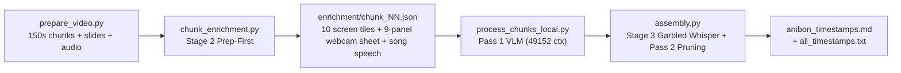

# Prep-First & Full-Context 48K Pipeline Architecture (`anibon-timestamper-local`)

- **Skill Spec**: [SKILL.md](file:///Users/zenithth/.gemini/config/plugins/anibon-stream-synthesis/skills/anibon-timestamper-local/SKILL.md)
- **Config File**: [config.json](file:///Users/zenithth/.gemini/config/plugins/anibon-stream-synthesis/skills/anibon-timestamper-local/config.json) / [config.py](file:///Users/zenithth/.gemini/config/plugins/anibon-stream-synthesis/lib/common/config.py)
- **Launcher**: [launch_local.sh](file:///Users/zenithth/.gemini/config/plugins/anibon-stream-synthesis/skills/anibon-timestamper-local/scripts/launch_local.sh)
- **Stage 1 Acquisition & Dictionary Scripts**: [[prepare-video-py]], [[update-garbled-dictionary-py]]
- **Stage 2 Prep-First Enrichment & Media Scripts**: [[chunk-enrichment-py]], [[chunk-storyboard-prep-py]], [[audio-webcam-cues-py]], [[obs-layout-py]], [[webcam-storyboard-py]], [[chunk-scanner-py]]
- **Stage 3–5 Inference, Assembly & QA Gates**: [[process-chunks-local-py]], [[dynamic-chunk-py]], [[prompts-py]], [[domain-db-and-fgo-py]], [[assembly-py]], [[audit-gaps-and-check-sections]]
- **Wiki Knowledge Automation**: [[anibon-wiki-tools]]
- **Post-Mortem Verification**: [[post-mortem-scrutinize-cqll7dq35bw]]

## 1. Architectural Shift: Why Prep-First & Full-Context 48K?
Prior to commit `3a5a039`, `anibon-timestamper-local` truncated chunk transcripts to 65 lines, capped livechat to 10 lines, dropped screen storyboard tiles whenever webcam frames were injected (`trim_storyboard_frames`), and ran with `context_length: 24576` (which reached 81–98% saturation on dense chunks, causing context-brim hallucinations).

The **Prep-First & Full-Context 48K** architecture solves this in two steps:
1. **Stage 2 Prep-First Enrichment (`--enrich` default `True`)**: Before Pass 1 inference begins, [[chunk-enrichment-py]] iterates through all 150s chunks and writes `enrichment/chunk_NN.json` containing:
   - `storyboard_frames`: 10 cropped full-screen storyboard tiles via [[chunk-storyboard-prep-py]].
   - `webcam_sheets`: Up to 9 cropped `320x320` webcam panels at audio RMS peaks (`loud_peak`), silence drops (`silence_drop`), `(0, -2s, +2s)` onset/follow-through offsets, and deictic speech cues (`ดูกล้อง`, `ดูนี่`), normalized with `,setsar=1` into a single 3×2 or 3×3 grid JPEG with a panel timestamp legend via [[webcam-storyboard-py]].
   - `song` & `recovered_items`: Shazam song detection → `audio.cpp` (`:8080`) Demucs vocal split → `whisper.cpp` (`:8081`) speech recovery.
2. **2× Context Headroom (`context_length: 49152`, `parallel: 1`)**: Doubling the context window on Tesla P100 16GB (`gemma-4-12b-it-qat@q4_k_xl`) keeps peak prompt usage (`~19.9k` tokens on [[stream-cqll7dq35bw]]) below 41% of capacity, eliminating context-brim hallucinations while sending 100% of transcript lines, livechat, 10 screen tiles, and the 9-panel webcam sheet untrimmed.

## 2. Pipeline Dataflow

## 3. Stage 5 Hardening & Optional FGO NP Enrichment (`2026-11-25`)
See [[code-change-stage5-guards-fgo-np-2026-11-25]]:
- **Pipeline Guards & Telemetry**: Non-Thai BGM chunk short-circuit (`_is_non_thai_bgm_chunk`, `_short_circuit_bgm_chunk` in `lib/process/runners/recursive.py`), donor handle & domain-switch guards in [[prompts-py]], Thai `[Tag]` normalization (`normalize_tag` in `lib/common/timestamps.py`), leaked-timestamp header checks in [[audit-gaps-and-check-sections]], and `prompt_tokens` / `total_tok_per_sec` reporting in [[process-chunks-local-py]].
- **Optional FGO NP Lookup**: `--with-np` / `servant_np` SQLite table in [[domain-db-and-fgo-py]] (`fetch_fgo_db.py`, `domain_db.py`).
- **World Identity & Skill Hardening**: Updated `skills/anibon-timestamper-local/{SKILL.md, references/hardware-and-endpoints.md, references/stage5-audit-checklist.md}` and World Identity references (`Annihilated.md`, `Loop_Hero.md`, `Bleach.md`, `Arknights_Endfield.md`, `Blue_Archive.md`, `Tokusatsu_Project_RED.md`, `INDEX.md`, `thai_phonetic_bridge.json`).
