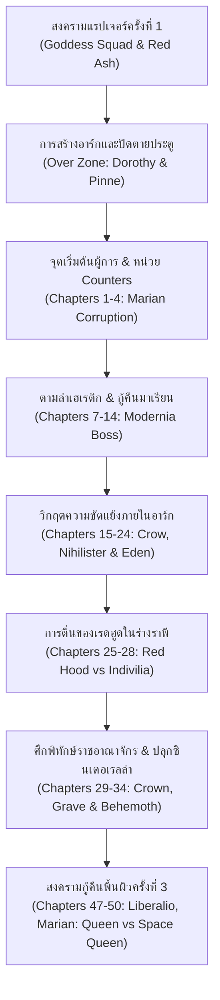

# 🔫 Goddess of Victory: Nikke (นิกเกะ / GODDESS OF VICTORY: NIKKE) - Deep Knowledge Base

คู่มืออ้างอิงข้อมูลเชิงลึกเวอร์ชันแพตช์ ตัวละคร (Nikkes) สังกัดผู้ผลิต (Manufacturers) ระบบการต่อสู้ และศัพท์คอมมูนิตี้ไทยของเกม **Goddess of Victory: Nikke (NIKKE)** สำหรับใช้ประกอบการทำไทม์สแตมป์สตรีมช่อง Anibon Official

---

## 🗓️ ประวัติการอัปเดตและทำเนียบ Nikkes (Version & Nikke History)

### 📌 ปี 2026 — ปีที่ 4 (สงครามกู้คืนพื้นผิวครั้งที่ 3 & Climax of Underground Ark)
*การเผชิญหน้าครั้งประวัติศาสตร์เพื่อปิดฉากเนื้อเรื่อง Underground Ark และเปิดฉาก 3rd Surface Recapture War*

| เวอร์ชัน / ช่วงเวลา | ตัวละครใหม่ (SSR / SR) | สาย / เบิสต์ / อาวุธ | โค้ดธาตุ / สังกัด | บทบาทและรายละเอียดแพตช์ |
| :---: | :--- | :---: | :---: | :--- |
| 4.0 (29 ต.ค. 2026 - Upcoming) | **Marian: Queen (มาเรียน: ควีน)** | Attacker / Burst III / MG | Fire / Pilgrim | ฉลองครบรอบ 4 ปี นิกเกะพิลกริมร่างราชินี แข่งขันกับ Space Queen โจมตีหมู่และเร่งดาเมจมหาศาล (สกิน Last Affection, บทที่ 49-50, อีเวนต์ MARIA-n) |
| 4.0 (29 ต.ค. 2026 - Upcoming) | **Scarlet: Goddeath (สการ์เล็ต: ก็อดเดธ)** | Attacker / Burst III / AR | Fire / Pilgrim | ฮงรยอนร่างอัปเกรดเทคโนโลยี Eden ถือดาบผ่าสสารมืดที่หลอมจากดาบจางฮวา เจาะเกราะทะลวงร่างลิลิธ |
| 4.0 (29 ต.ค. 2026 - Upcoming) | **Rapunzel: Sanctuary (ราพันเซล: แซงก์ทัวรี)** | Supporter / Burst I / SR | Iron / Pilgrim | ร่างโป๊ปเทคโนโลยี Red Shoes ตัวซัพพอร์ตคล่องตัวสูง *แจกฟรี 4 ตัวในกิจกรรม 4th Anniversary* |
| Oct 8, 2026 (Live V_0) | **Belorta: Pumpkin Witch (เบลอร์ต้า: พัมป์คิน วิทช์)** | Supporter / Burst II / RL | Water / Tetra Line | อีเวนต์ "LITTLE WITCH TRICK" เบลอร์ต้าร่าง SSR แม่มดฮาโลวีน บัฟดาเมจเพื่อนร่วมทีมเมื่อกดเบิสต์ (ไซด์สตอรี่ Gingerbread House) |
| Sep 17, 2026 (V_-1) | **Guilty: Mighty Bunny (กิลตี้: ไมตี้ บันนี่)** | Attacker / Burst III / SG | Water / Missilis | อีเวนต์ "COIN RUSH SHOWDOWN" บันนี่เกิร์ลสายโจมตีเป้าหมายเดี่ยวรุนแรงตามสเกล ATK ตัวเอง |
| Sep 24, 2026 (V_-1) | **Sin: Swift Bunny (ซิน: สวิฟต์ บันนี่)** | Attacker / Burst II / AR | Water / Missilis | บันนี่เกิร์ลสายโจมตีหมู่ พร้อมการปรับปรุงระบบโอเวอร์โหลด (Overload Gear QoL) และ Solo Raid S41 |
| Sep 3, 2026 (V_-2) | **Drake: Great Villain (เดรค: เกรต วิลเลียน)** | Defender / Burst III / SG | Wind / Missilis | อีเวนต์ "GREAT VILLAIN UNION" สเกลพลังโจมตีตาม Max HP ตัวเอง พร้อมการยกเครื่องโครงสร้างไฟล์เกม (Data Architecture Redesign) |
| Aug 13, 2026 (V_-3) | **Queen: Makoto Niijima (ควีน / มาโคโตะ)** | Attacker / Burst I / SG | Fire / Abnormal | คอลแลบ *PERSONA ON FRONTLINE* (Persona 30th Anniversary) ดาเมจไฟเบิสต์ 1 ปลดล็อกเนื้อเรื่องหลักบทที่ 47-48 (บอส Liberalio Body) |
| Aug 20, 2026 (V_-3) | **Yukiko Amagi (ยูกิโกะ อามากิ)** | Attacker / Burst I / AR | Fire / Abnormal | ตัวละครคอลแลบ Persona 4 Golden เฟส 2 ดาเมจไฟสายเร่ง Burst |
| Aug 13, 2026 (V_-3) | **Aigis (ไอจิส)** | Supporter / Burst I / SMG | Iron / Abnormal | แอนดรอยด์สาวจาก Persona 3 Reload ตัวซัพพอร์ตเหล็ก *แจกฟรี SR ประจำอีเวนต์* |
| Jul 23, 2026 (V_-4) | **Laplace: Ultimate Hero (ลาพลาส: อัลติเมท ฮีโร่)** | Attacker / Burst III / RL | Wind / Missilis | อีเวนต์ "Project Matis" ลาพลาสร่างพัฒนา Missilis ยิงจรวดสะสมประจุเจาะเกราะ Pierce ดาเมจมัลติฮิตถล่มบอส |

---

### 📌 ปี 2024 - 2025 — ยุค Old Tales และ Last Kingdom (Anniversaries & Pilgrims)
*ยุคทองของการเปิดเผยอดีตโมเดล Grimms รุ่นที่ 2 และการปกป้องอาณาจักรคราวน์*

| เวอร์ชัน / ช่วงเวลา | ตัวละครใหม่ (SSR / SR) | สาย / เบิสต์ / อาวุธ | โค้ดธาตุ / สังกัด | บทบาทและรายละเอียดแพตช์ |
| :---: | :--- | :---: | :---: | :--- |
| Oct 31, 2024 (2nd Anniv) | **Cinderella (ซินเดอเรลล่า / อนาคิโร)** | Defender / Burst III / RL | Electric / Pilgrim | ฉลองครบรอบ 2 ปี นิกเกะโมเดล Grimms รุ่น 2 สายป้องกันไฟฟ้าสะท้อนดาเมจกระจก (อีเวนต์ "OLD TALES", มินิเกม In the Mirror, บทที่ 33-34 บอส Behemoth) |
| Oct 31, 2024 (2nd Anniv) | **Grave (เกรฟ)** | Supporter / Burst II / AR | Fire / Pilgrim | ผู้พิทักษ์โลงแก้วซินเดอเรลล่า ซัพพอร์ตเจาะเกราะและเร่งเกจเบิสต์ |
| Oct 31, 2024 (2nd Anniv) | **Rapunzel: Pure Grace (ราพันเซล: เพียว เกรซ)** | Defender / Burst I / SR | Iron / Pilgrim | ราพันเซลร่างอดีตยุคเทพีโมเดล Grimms รุ่น 1 *แจกฟรี SSR ประจำอีเวนต์ครบรอบ 2 ปี* |
| Aug 22, 2024 (Collab) | **Asuka Shikinami Langley (อาสึกะ)** | Attacker / Burst III / AR | Fire / Abnormal | คอลแลบ *Evangelion* ดาเมจไฟเจาะเกราะทะลวงแกนคอร์ศัตรู |
| Aug 29, 2024 (Collab) | **Rei Ayanami (เรย์ อายานามิ)** | Attacker / Burst III / MG | Fire / Abnormal | คอลแลบ *Evangelion* ปืนกลหนักไฟสายฉีดดาเมจต่อเนื่อง |
| Sep 5, 2024 (Collab) | **Mari Makinami Illustrious (มาริ)** | Supporter / Burst II / SR | Electric / Abnormal | สไนเปอร์ซัพพอร์ตไฟฟ้า เพิ่มดาเมจเจาะเกราะให้เพื่อนร่วมทีม (ฟรี SR Misato Katsuragi) |
| Jul 4, 2024 (Summer) | **Sakura: Bloom in Summer (ซากุระ หน้าร้อน)** | Attacker / Burst III / AR | Wind / Tetra Line | อีเวนต์ "BEAUTY FULL SHOT" ดาเมจลมเป้าหมายเดี่ยวสายตัดชิ้นส่วนบอส |
| Jul 4, 2024 (Summer) | **Rosanna: Chic Ocean (โรซานนา หน้าร้อน)** | Supporter / Burst I / AR | Wind / Tetra Line | ซัพพอร์ตลมเพิ่มดาเมจชิ้นส่วนและดาเมจคริติคอล |
| Apr 25, 2024 (1.5 Anniv) | **Crown (คราวน์ / ราชินีคราวน์)** | Defender / Burst II / MG | Iron / Pilgrim | ครบรอบ 1.5 ปี เสาหลักเมต้า บัฟ ATK มหาศาลเมื่อได้รับการฮีล โล่ป้องกันอมตะ (อีเวนต์ "Last Kingdom", บทที่ 29-30 บอส Indivilia) |
| Apr 25, 2024 (1.5 Anniv) | **Kilo (กิโล & T.A.L.O.S.)** | Defender / Burst III / MG | Fire / Missilis | นิกเกะขับหุ่นยนต์ยักษ์ T.A.L.O.S. *แจกฟรี SSR ประจำอีเวนต์ครบรอบ 1.5 ปี* |
| Jan 1, 2024 (New Year) | **Scarlet: Black Shadow (สการ์เล็ต แบล็กแชโดว์)** | Attacker / Burst III / RL | Wind / Pilgrim | ฮงรยอนชุดดำสะบัดดาบสร้างพายุคลื่นลม ฟันตัดรอบทิศทางตามจำนวนชาร์จ ยืนหนึ่งเรื่อง DPS |

---

### 📌 ปี 2022 - 2023 — ยุคบุกเบิกและมรดก Goddess Squad
*การเปิดตัวตำนานนิกเกะรุ่นแรก สงคราม Over Zone และความลับการล่มสลายของพื้นผิว*

| เวอร์ชัน / ช่วงเวลา | ตัวละครใหม่ (SSR / SR) | สาย / เบิสต์ / อาวุธ | โค้ดธาตุ / สังกัด | บทบาทและรายละเอียดแพตช์ |
| :---: | :--- | :---: | :---: | :--- |
| Nov 2, 2023 (1st Anniv) | **Red Hood (เรดฮูด / หมวกแดง)** | Attacker / Burst I, II, III / SR | Iron / Pilgrim | ฉลองครบรอบ 1 ปี ตัวเดียวในเกมที่กดสกิล Burst ได้ทุกระดับ (B1/B2/B3) อาวุธ Wolfsbane เจาะเกราะรุนแรงสูงสุด (อีเวนต์ "Red Ash", บทที่ 25-26 บอส Ultra) |
| Nov 2, 2023 (1st Anniv) | **Snow White: Innocent Days (สโนว์ไวท์จิ๋ว)** | Attacker / Burst III / AR | Iron / Pilgrim | สโนว์ไวท์ร่างเด็กไร้เดียงสายุค Goddess Squad *แจกฟรี SSR ฉลองครบ 1 ปี* |
| Sep 1, 2023 (Collab) | **2B (ทูบี / YoRHa No.2 Type B)** | Defender / Burst III / AR | Fire / Abnormal | คอลแลบ *NieR:Automata* ดาเมจสเกลตาม Max HP รุนแรงระดับท็อป (ตู้คู่ A2 และแจกฟรี SR Pascal) |
| Apr 27, 2023 (0.5 Anniv) | **Dorothy (โดโรธี / ยัยบัวขาว)** | Supporter / Burst I / AR | Water / Pilgrim | ผู้นำทีม Inherit แห่ง Eden ซัพพอร์ตลดคูลดาวน์ Burst และ Brand ระเบิดดาเมจสะสม (อีเวนต์ "Over Zone", บอส Mother Whale) |
| Jan 1, 2023 (New Year) | **Modernia (โมเดิร์นเนีย / มาเรียน)** | Attacker / Burst III / MG | Fire / Pilgrim | ร่างเฮเรติกที่ถูกชิงตัวกลับมา ปืนกลขยายกระสุนไม่จำกัดและยิงล็อคเป้าอัตโนมัติ 15 วินาที เสาหลักการผ่านด่านเนื้อเรื่อง |
| Nov 4, 2022 (Launch) | **Rapi (ราพี)** | Attacker / Burst III / AR | Fire / Elysion | นิกเกะแกนนำหน่วย Counters ผู้แบกรับแกนพลังงานของ Red Hood |
| Nov 4, 2022 (Launch) | **Anis (อนิส)** | Defender / Burst II / RL | Iron / Tetra Line | สาวน้อยอารมณ์ขัน เสาหลักด้านตรรกะและมิตรภาพของหน่วย Counters |
| Nov 4, 2022 (Launch) | **Neon (นีออน)** | Supporter / Burst I / SG | Fire / Elysion | สาวแว่นคลั่ง "พลังยิง" (Firepower) สายสืบลับของ CEO อิงกริด |
| Nov 4, 2022 (Launch) | **Liter (ลิเตอร์ / ยายลิเตอร์)** | Supporter / Burst I / SMG | Iron / Missilis | เทพซัพพอร์ตตลอดกาล ลด CD Burst, ซ่อมที่กำบัง (Cover), บัฟ ATK มหาศาล |

---

## 🏢 สังกัดผู้ผลิตและหน่วยรบหลัก (Manufacturers & Squads)

### 1. The Big Three (สามบริษัทยักษ์ใหญ่แห่งอาร์ก)
- **Elysion (เอลีเชียน):** บริหารโดยซีอีโอ **Ingrid (อิงกริด)** มุ่งเน้นยุทโธปกรณ์ทางการทหารแท้จริง ระเบียบวินัย และการรักษาความสงบของรัฐบาลกลาง
  - **Counters:** Rapi, Anis, Neon (หน่วยของผู้การตัวเอก)
  - **Absolute:** Eunhwa (อึนฮวา - หัวหน้า), Emma (เอ็มม่า - ทำอาหารแย่แต่ฮีลเก่ง), Vesti (เวสตี้ - เงียบแต่โหดเหี้ยม)
  - **Triangle:** Privaty (พริวาตี - ซึนเดเระ), Yulha (ยุลฮา - สาวออฟฟิศหมดไฟ), Admi (แอดมิ)
  - **Infinity Rail:** Diesel (ดีเซล - ลูกอมสตรอว์เบอร์รี), Brid (บริด), Soline (โซลีน)
  - **A.C.P.U. (ตำรวจอาร์ก):** Poli (โพลี่ - ตำรวจหมา), Miranda (มิรันดา), Quiry (ควิรี - สายตาสั้น)
  - **Perilous Siege:** D (ดี - เพชฌฆาตสาวลอบสังหาร), K (เค)
  - **Extrinsic:** Maiden (เมเดน - สาวโอตาคุหน้ากากกุหลาบ), Guillotine (กิลโยติน - สาวเบียวจูนิเบียว)
  - **Aegis (กองทัพเรือบนบก):** Helm (เฮล์ม - กัปตันเรือ Admire), Mast (มาสต์), Anchor (แองเคอร์)

- **Missilis Industry (มิสซิลิส อินดัสทรี):** บริหารโดยซีอีโอ **Syuen (ชูเอน)** มุ่งเน้นเทคโนโลยีล้ำสมัย การทดลองไซบอร์ก และนวัตกรรมอาวุธ
  - **Matis:** Laplace (ลาพลาส - ฮีโร่ผู้ชอบพังหน้าต่าง), Drake (เดรค - วายร้ายที่ทำแต่เรื่องดี), Maxwell (แมกซ์เวลล์ - นักวิจัยสาวหื่น)
  - **Mighty Tools:** Liter (ลิเตอร์ - ช่างก่อสร้างร่างโลลิแต่ประสบการณ์ยาย), Centi (เซนติ - ช่างก่อสร้างสาวกระฉับกระเฉง)
  - **Exotic:** Crow (โครว - ผู้ก่อการร้ายตัวอันตราย), Viper (ไวเปอร์ - อสรพิษเจ้าเล่ห์), Jackal (แจ็คเคิล - สุนัขจรจัดผู้ซื่อสัตย์)
  - **Wardress:** Yuni (ยูนิ), Mihara (มิฮาระ)
  - **Real Kindness (นักโทษฟื้นฟู):** Guilty (กิลตี้ - พลังบีบกระดูกแหลก), Sin (ซิน - สะกดจิต), Quency (เควนซี่ - ราชินีแหกคุก)
  - **Dazzling Pearl / School Circle:** Tia (เทีย - สาวมังกรชอบของหวาน), Naga (นากา), Marciana (มาร์เชียนา), Ein (ไอน์), Rei (เรย์)
  - **M.M.R. High School:** Elegg (เอเลกก์ - ผู้ติดตั้งเกม BOOM บนทุกหน้าจอ), Trony (โทรนี - สาวฮิคิโคโมริติดเน็ต)

- **Tetra Line (เททรา ไลน์):** บริหารโดยซีอีโอ **Mustang (มัสแตง - "ENTERTAINMENTTT!")** มุ่งเน้นความบันเทิง แฟชั่น วัฒนธรรม และคุณภาพชีวิตของชาวอาร์ก
  - **Cafe Sweety:** Sugar (ชูการ์ - สาวมอเตอร์ไซค์กาแฟดำ), Milk (มิลก์), Frima (ฟรีม่า - สาวขี้เซานอนหลับตลอดเวลา)
  - **Underworld Queen (มาเฟียคุมใต้ดิน):** Sakura (ซากุระ - หัวหน้าแก๊งยากูซ่าเซย์ริวไค), Rosanna (โรซานนา - หัวหน้ามาเฟียเฮดดรากอน), Moran (โมรัน - หัวหน้าแก๊งเปโอนี่ซื่อตรง)
  - **777 (กาสิโนคอยน์รัช):** Blanc (บล็อง - กระต่ายขาวนำโชค), Noir (นัวร์ - กระต่ายดำขี้อาย), Rouge (รูจ - นักคำนวณไพ่)
  - **Talentum (นักธุรกิจพันล้าน):** Rupee (รูปี - สตรีมเมอร์นักช้อปปิ้ง), Yan (ยัน - สาวพ่อค้าสำเนียงคันไซ), Dolla (ดอลล่า)
  - **Prima Donna (วงดนตรีอาร์ก):** Noise (นอยส์), Volume (วอลุ่ม), Aria (อาเรีย)
  - **Unlimited (หน่วยกู้ภัยแดนหิมะ):** Ludmilla (ลุดมิลล่า - ราชินีแดนเหนือสัมผัสไฟฟ้าดับ), Alice (อลิส - สาวสไนเปอร์แดนมหัศจรรย์), Tove (โทฟ), Neve (เนฟ)
  - **Maid For You:** Ade (เอด - หัวหน้าแม่บ้านสุดเพอร์เฟกต์), Cocoa (โคโค่ - แม่บ้านซอสมะเขือเทศ), Soda (โซดา - แม่บ้านซุ่มซ่าม)

---

### 2. Pilgrim (พิลกริม — นิกเกะอิสระนอกอาร์ก)
นิกเกะเทคโนโลยีรุ่นบุกเบิกและรุ่นพิเศษที่ไม่ได้ขึ้นตรงต่อรัฐบาลกลาง อาศัยอยู่บนพื้นผิวโลกที่เต็มไปด้วยแรปเจอร์:
- **Goddess Squad (หน่วยเทพีรุ่นแรก - First Generation Grimms):**
  - **Lilith / Liliweiss (ลิลิธ / ลิลิไวส์):** ผู้นำหน่วยเทพี แข็งแกร่งที่สุดในประวัติศาสตร์มนุษยชาติ
  - **Red Hood (เรดฮูด):** สไนเปอร์ผมแดงผู้ใช้พลัง Wolfsbane
  - **Snow White (สโนว์ไวท์):** ผู้ถือครองอาวุธ Seven Dwarves กินทุกอย่างที่ขวางหน้าเพื่อความอยู่รอด
  - **Dorothy (โดโรธี):** เทพีผู้สง่างาม ถูกอาร์กหักหลังจนกลายเป็นผู้นำ Eden
  - **Scarlet / Hongryeon (สการ์เล็ต):** ยอดนักดาบซามูไรผู้รักการดื่มเหล้าหมัก
  - **Rapunzel (ราพันเซล):** นักบวชสาวผู้บันทึกความทรงจำของเพื่อนที่ล่วงลับ
- **2nd Generation Grimms Models (โมเดลรุ่นที่สอง):**
  - **Cinderella / Anachiro (ซินเดอเรลล่า / อนาคิโร):** กระจกแก้วคริสตัล ถูกการทุจริตกลายเป็นเฮเรติกก่อนจะได้รับการกู้คืน
  - **Grave (เกรฟ):** ผู้แบกโลงแก้วเดินทางข้ามทวีปเพื่อคืนชีพซินเดอเรลล่า
  - **Little Mermaid (ลิตเติล เมอร์เมด):** นางเงือกแห่งท้องทะเลลึก
  - **Red Shoes (เรด ชูส์):** ผู้พัฒนาวิทยาการต้องห้าม
- **Inherit (หน่วยสืบทอดแห่งสวรรค์ Eden):** Dorothy, Harran (ฮารัน - แม่มดนกกา), Isabel (อิซาเบล - นิกเกะคลั่งรักผู้การ), Noah (โนอาห์ - เจ้าของโล่บาเรียสุดกวน)
- **White Knights (อาณาจักรคราวน์):** Crown (คราวน์ - ราชินีผู้พิทักษ์ปราสาท), Chime (ไชม์ - เสนาธิการตัวเล็ก), Marian / Modernia (เนเค็ดคิง), Kilo & T.A.L.O.S.
- **Heretics (เฮเรติก — นิกเกะที่ถูกราชินีแรปเจอร์ครอบงำ):** Modernia (อดีต), Nihilister (มังกรเพลิง), Indivilia (แมงป่องเหล็ก), Liberalio (ราชินีแมงกะพรุนขี้เซา), Behemoth (อสูรกลืนกิน), Leviathan (สัตว์ประหลาดแห่งท้องทะเล)

---

## 📖 ไทม์ไลน์เนื้อเรื่องหลักและตำนานสงคราม (Main Story & Lore Chronology)

1. **First Rapture Invasion & Red Ash:** มนุษยชาติถูกสิ่งมีชีวิตชีวจักรกลต่างดาว "Rapture" รุกราน รัฐบาลสร้างนิกเกะรุ่นทดลอง Goddess Squad นำโดย Lilith, Red Hood, Snow White, Dorothy, Scarlet, Rapunzel และซินเดอเรลล่า (ถูกไวรัสแรปเจอร์แทรกซึมกลายเป็น Anachiro)
2. **Ark Sealing & Over Zone:** มนุษย์อพยพลงสู่นครใต้ดิน "The Ark" และสั่งปิดตายประตูกักขัง Goddess Squad ไว้บนพื้นผิว ทหาร Pinne เสียชีวิต ทำให้จิตใจของ Dorothy แตกสลายและสาบานว่าจะกลับมาล้างแค้นอาร์ก
3. **Counters & Marian (Chapters 1 - 14):** ผู้การหน้าใหม่เข้ารับตำแหน่ง ออกรบพร้อม Marian แต่เธอถูกไวรัสแรปเจอร์แทรกซึมจนต้องประหารชีวิตด้วยมือตนเอง ผู้การก่อตั้งหน่วย Counters ร่วมกับ Rapi, Anis, Neon ต่อมาพบว่ามาเรียนถูกดัดแปลงเป็นเฮเรติก "Modernia" ในที่สุดผู้การสามารถกู้ความทรงจำและแย่งตัวเธอกลับมาได้ แต่ต้องส่งมอบให้ Pioneer ดูแลเพื่อความปลอดภัย
4. **Ark Terror & Eden Alliance (Chapters 15 - 24):** Crow นำลัทธิ Heavenly Ascension ก่อวินาศกรรมถล่มอาร์ก นำพาเฮเรติก Nihilister เข้าโจมตี ผู้การได้รับบาดเจ็บสาหัสและได้รับการช่วยเหลือจนค้นพบสวรรค์เทคโนโลยีลอยฟ้า "Eden" ของโยฮันและเซซิล
5. **Red Hood Awakening (Chapters 25 - 28):** แกนพลังงานของ Red Hood ภายในตัว Rapi ตื่นขึ้น ช่วยทีมกำราบ Indivilia และ Chatterbox พร้อมสำรวจ Crystal Region และได้พบกับ Grave
6. **Crown's Kingdom & Cinderella (Chapters 29 - 34):** Crown และ Chime ปกป้องปราสาทและแกนพลังงานบริสุทธิ์จาก Indivilia และ Chatterbox ขณะที่ Grave ลำเลียงโลงแก้วของ Cinderella จนปลุกเธอให้ตื่นขึ้นมาต่อสู้กับ Behemoth
7. **3rd Surface Recapture War (Chapters 35 - 50):** รัฐบาลกลางอาร์กร่วมมือกับพิลกริมเปิดศึกชิงพื้นผิวโลกครั้งใหญ่ เผชิญหน้าร่างสมบูรณ์ของ Liberalio และก้าวเข้าสู่ศึกตัดสินระหว่าง Marian: Queen และ Space Queen เพื่อกำหนดชะตากรรมของมนุษย์และนิกเกะ

---

## ⚔️ ระบบการต่อสู้และคำศัพท์เชิงเทคนิค (Core Mechanics & Terminology)

*   **Burst Skill & Full Burst (สกิลเบิสต์และฟูลเบิสต์):** การต่อสู้จัดทีม 5 ตัวละคร เรียงลำดับกด Burst I (20s/40s) -> Burst II (20s/40s) -> Burst III (40s) เข้าสู่โหมด **Full Burst 10 วินาที** ที่รวมพลังเล็งเป้าหมายเดียวกันและดาเมจพุ่งสูงสุด
*   **20s Cooldown Priority:** เมต้าทีมจำเป็นต้องมีตัว Burst I และ Burst II ที่มีคูลดาวน์สกิลเพียง 20 วินาที (เช่น Liter, Dorothy, Crown, Blanc) เพื่อให้กดวน Full Burst ได้ต่อเนื่องทุกรอบ
*   **Elements / Codes (โค้ดธาตุ):** Fire (ไฟ), Water (น้ำ), Wind (ลม), Electric (ไฟฟ้า), Iron (เหล็ก) ระบบชนะทางธาตุเพิ่มดาเมจ 10% และบังคับใช้ทำลายโล่ธาตุใน Solo Raid
*   **Overload Gear (อุปกรณ์โอเวอร์โหลด / เกียร์ OL):** อุปกรณ์ระดับ Tier 9 Manufacturer (T9M) ที่อัปเกรดถึงเลเวล 5 แล้วใช้หิน Custom Module เปลี่ยนเป็นเกียร์ Tier 10 ปลดล็อกออปชันพิเศษ (Max Ammo Capacity, ATK, Elemental Damage, Crit Rate/DMG)
*   **Favorite Item / Collection Item (ไอเทมของสะสม / เฟเวอริต):** ระบบติดตั้งตุ๊กตา (Doll) อัปเกรดขีดจำกัดเพื่อพัฒนาสกิลของตัวละครดั้งเดิม (เช่น Laplace, Diesel, Frima, Viper, Exia, Centi) ให้กลับมาติดเมต้าระดับสูง
*   **Anomaly Interception:** ระบบท้าทายบอสระดับสูงยุคใหม่สำหรับฟาร์มหินคัสตอมโมดูลและเกียร์ T9M โดยเฉพาะ
*   **Synchro Device & 160 Wall (กำแพงเลเวล 160):** ระบบแชร์เลเวลให้ตัวละครทั้งไอดี โดยผู้เล่นต้องมีตัวละคร SSR ปลดดาวสูงสุด 3 ดาว (MLB - 4 ตัวซ้ำ) จำนวน 5 ตัว เพื่อดันเลเวลทะลุกำแพง 160 ก้าวสู่เลเวล 200+

---

## 💬 ชื่อเรียกและศัพท์คอมมูนิตี้ไทย (Thai Community Slang & Nicknames)

*   **ยายลิเตอร์ / ปู่ลิเตอร์:** Liter (ซัพพอร์ตเมต้าเบอร์ 1 ของเกม นิสัยแก่แต่ตัวเล็ก)
*   **หมวกแดง:** Red Hood (พิลกริมสุดโกง กดเบิสต์ได้ทุกขั้น B1/B2/B3)
*   **ยัยบัวขาว / เจ๊โดโรธี:** Dorothy (พิลกริมสาวผู้สง่างามแต่จิตใจเคียดแค้นอาร์ก)
*   **หลวงเจ๊ / แม่ชีหื่น:** Rapunzel (ราพันเซลผู้ชอบเก็บหนังสือโป๊และคิดลึกตลอดเวลา)
*   **น้องเบลบอส / ลิงกอริลลา:** Chatterbox (แรปเจอร์ระดับสูงที่ชอบโผล่มาต่อรองและโดนยิงหน้าหงาย)
*   **ชูเอนหมาเอนิกค์:** Syuen (ซีอีโอ Missilis ที่ปากดีขี้เหวี่ยงแต่โดน Enikk ลงโทษดัดหลัง)
*   **กำแพง 160:** จุดตันของผู้เล่นใหม่ที่ยังปลด SSR 3 ดาวไม่ครบ 5 ตัว
*   **ตู้ทอง 200 ไมล์:** การสะสม Gold Mileage Ticket 200 ใบ เพื่อแลกตัวละครหน้าตู้การันตี 100% โดยไม่รีเซ็ตแต้ม
*   **กระต่ายคู่:** Blanc & Noir (ดูโอกระต่ายขาวดำ บัฟอมตะและเพิ่มกระสุน)
*   **นักเรียนคู่:** Tia & Naga (ดูโอสาวโรงเรียน บัฟดาเมจคอร์และโล่ป้องกัน)
