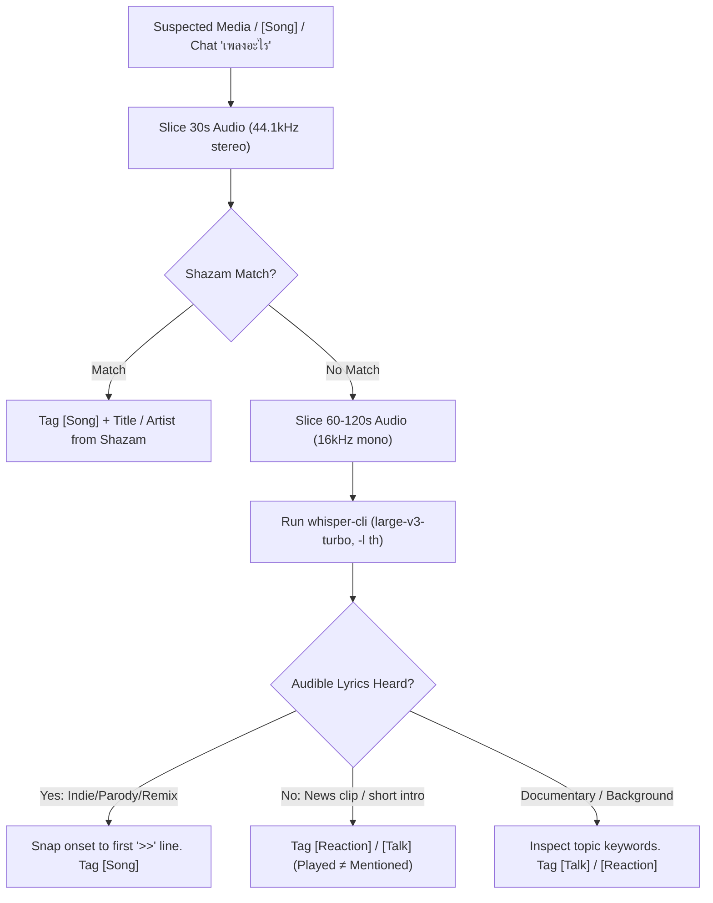

# Media & Audio Ground Truth Verification

Guide for verifying music, parody songs, and media clips played on Anibon streams.

## Decision Flow



---

## 1. Fast CLI Extraction Recipes

### Audio Slice for Shazam (44.1kHz Stereo)
```bash
# Get direct audio URL
STREAM_URL=$(yt-dlp -g -f 140 "https://www.youtube.com/watch?v=VIDEO_ID")

# Slice 30s at offset (e.g. 03:42:00 = 13320s)
ffmpeg -y -ss 13320 -i "$STREAM_URL" -t 30 -vn -ar 44100 -ac 2 /tmp/shazam_slice.wav
```

### Audio Slice for Whisper.cpp (16kHz Mono)
```bash
# Slice 60-120s around media playback
ffmpeg -y -ss 27810 -i "$STREAM_URL" -t 90 -vn -ar 16000 -ac 1 -c:a pcm_s16le /tmp/whisper_slice.wav

# Run Whisper large-v3-turbo with timestamps
whisper-cli -m ~/.cache/whisper/ggml-large-v3-turbo.bin \
  -l th -otxt -of /tmp/whisper_slice /tmp/whisper_slice.wav
cat /tmp/whisper_slice.txt
```

---

## 2. Shazam Fingerprinting Script

Sequential calls to `shazamio` can hang indefinitely without timeouts. Always wrap calls with `asyncio.wait_for`:

```python
import asyncio
from shazamio import Shazam

async def identify_audio(file_path: str, timeout_sec: float = 15.0) -> dict | None:
    shazam = Shazam()
    try:
        return await asyncio.wait_for(shazam.recognize(file_path), timeout=timeout_sec)
    except asyncio.TimeoutError:
        return None

# Run via uv: uv run --with shazamio python3 -c '...'
```

---

## 3. Core Verification Rules

### Rule 1: Fingerprint First, Fall Back to Acoustic Whisper
- Commercial releases and pop tracks match reliably on Shazam.
- Underground indie, parodies, drinking songs (เพลงแปลงวงเหล้า), and อ.ไม้ร่ม break melodic/harmonic conventions and do not exist in Shazam's database. Whisper large-v3-turbo acoustic transcription is required.

### Rule 2: Played ≠ Mentioned
- Streamer opening a 10s news soundbite or searching for a song on YouTube = `[Reaction]` / `[Talk]`.
- Tag `[Song]` **only** when audible lyrics and melody play through the stream audio.
- Never turn streamer spoken search phrases into played songs.

### Rule 3: Onset Snapping
- Never snap a song timestamp to the streamer's setup line or chunk boundary.
- Snap to the exact second of the first `>>` audio turn indicator or music intro chord.

### Rule 4: Split by Clip (One Artist ≠ One Song)
- Streamers frequently binge multiple clips of the same artist sequentially.
- Track lyric transitions and split into separate entries (e.g. Mairom: *น้องเนเน่* → *บทเพลงวันแม่*).

---

## 4. Case Study: Livestream `l00khgGzmIg`

| Time | Claim / Transcript Text | Verification Method | Ground Truth Result |
| :--- | :--- | :--- | :--- |
| `03:42:00` | Mystery intro track | Shazam | **Pink Guy** - "Are You Serious" / "White Is Right" (`[Song]`) |
| `03:44:30` | Spoken "พี่ไม่ได้ดักเจ้า" | Whisper + Web lyrics | **อ.ไม้ร่ม** - "พี่ไม่ได้ดักเจ้า" (Original & EDM Remix) |
| `07:16:34` | "เนเน่... นายแน่มาก" | Shazam / Audio | **แอ๊ด คาราบาว** - "เนเน่... นายแน่มาก" |
| `07:21:15` | Trap beat Carabao parody | Shazam | **GUNNER feat. YOUNGGU** - "แอ๊ดคาราบาว" |
| `07:30:09` | "เนเน่" clip cluster | Whisper | **อ.ไม้ร่ม** - "น้องเนเน่" (อ๊ะเหน่เน่) |
| `07:33:24` | Second Mairom clip | Whisper | **อ.ไม้ร่ม** - "บทเพลงวันแม่" (อูแว้ อูแว้) |
| `07:41:08` | Spoken "อุ๊งอิ๊งออกไป" | Whisper transcript | **Boat did NOT play song**; closed news clip. Labeled `[Reaction]`. |
| `07:43:45` | Spoken "ชาละวัน" | Whisper onset `>>` | **"ชาละวัน" (เพลงแปลง)**. Snapped to `07:43:45` (not `07:43:31`). |
| `07:49:23` | Hip-hop track | Shazam | **GETFLIX** - "ปล่อยตรงนี้" |
| `08:59:35` | "Pokémon Champions" | Whisper / Transcript | **Documentary** "นาลันทา อวสานพุทธศาสนาในอินเดีย". Tag `[Talk]`. |

---

## 5. `media_catalog.json` Schema

When encountering new recurring songs, persist them in `resources/media_catalog.json`.

> [!IMPORTANT]
> The top level of `media_catalog.json` is a JSON array (`list`). Each item must use `media_id` (not `id`):

```json
[
  {
    "media_id": "mairom_nene",
    "title": "น้องเนเน่",
    "artist": "อ.ไม้ร่ม",
    "aliases": ["เนเน่ ไม้ร่ม", "เหน่เหน่", "อ๊ะเหน่เน่"],
    "canonical_phrases": ["อ๊ะเหน่เน่", "น้องเนเน่", "เหน่เหน่"],
    "garble_patterns": ["เหน่ เหน่", "เนเน่ ไม้ร่ม"]
  }
]
```
