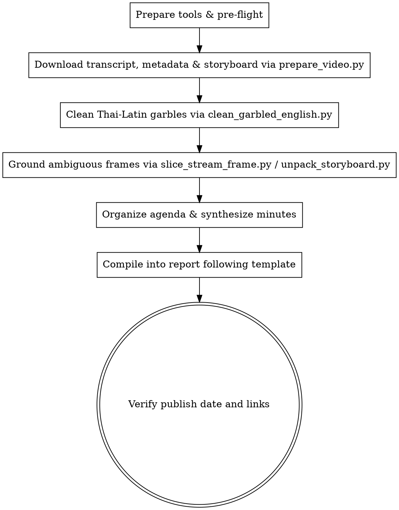

# YouTube Minutes Synthesis

A skill for extracting transcripts from YouTube videos, processing and analyzing them with canonical plugin tools, and producing structured meeting-minutes-style summaries or timestamped overviews as Markdown (.md) documents.

## When to Use

- When the user needs meeting minutes from a recorded meeting, conference, talk, or stream posted on YouTube.
- When summarizing key points from a video or interview with timestamps for easy reference.
- When repurposing a video transcript into an article, executive brief, or guide.

## Process Flow



## Checklist

Commands run from the plugin root directory (`anibon-stream-synthesis/`).

> [!IMPORTANT]
> **REQUIRED SUB-SKILL (FIRST):** Before anything else, run `preparing-tools` to verify all system dependencies (`yt-dlp`, `ffmpeg`, `python3`). Do NOT proceed if any tool is missing.

### 1. Prepare Workspace, Transcript & Metadata (Canonical Preparation)
Run the root pipeline utility `scripts/prepare_video.py`:

```bash
python3 -X utf8 scripts/prepare_video.py "<URL>" --format xml --block 600 --overlap 60
```

`scripts/prepare_video.py` automatically:
- Creates `~/youtube_<VIDEO_ID>_workspace/`.
- Probes and writes `<workspace>/info.json` (`upload_date`, `release_timestamp`, `title`, `duration`, `channel`).
- Downloads multi-language `json3` subtitles (prioritizing `th-orig,en-orig,th,en`) into `<workspace>/raw_transcript.json`.
- Downloads YouTube storyboard slide sheets into `<workspace>/frames/`.
- Cleans and segments the transcript into 10-minute XML chunks (`<workspace>/chunks/chunk_*.xml`).

**Verify Publish Date & Temporal Context — REQUIRED**:
- Read `<workspace>/info.json` (or `yt-dlp --dump-json "<URL>"`) to record the exact `upload_date` and `release_timestamp`.
- If the video is older than 6 months, add a note: **"Old video — context may differ from the present"** in the report.
- **NEVER attribute events or information that occurred after the publish date** to the speaker as if they said it during the video.

### 2. Clean Thai-Latin Garbles & Fallback Strategies
Normalize Whisper ASR phonetic drift and garbled loanwords across chunks:

```bash
python3 -X utf8 skills/cleaning-auto-transcripts/scripts/clean_garbled_english.py --chunks ~/youtube_<VIDEO_ID>_workspace/chunks/
```

#### No-Caption Fallback (Local Transcription)
If the YouTube video has no subtitles or auto-captions:
1. Load **`anibon-local-transcription`** to extract 16kHz audio and transcribe locally via `whisper.cpp`.
2. If audio $\ge 2\text{h}$ exhibits repetition loops or silent stutter, invoke **`whisper-corruption-recovery`** to clean and stitch `raw_transcript.json`.
3. Re-run `prepare_video.py` against the workspace to generate chunks.

#### Anti-Bot Block Handling (YouTube 429 / HTTP 403)
- **Local run**: Try `--extractor-args "youtube:player_client=android"` first to bypass YouTube SABR 403 blocks without macOS Keychain prompts. If sign-in is required, ask the user which browser they use and pass `--cookies-from-browser <browser_name>`.
- **Cloud Sandbox run**: `--cookies-from-browser` will fail in headless sandboxes. Ask the user to run `yt-dlp` locally and upload `raw_transcript.json` to the session.

### 2.B Visual Grounding & On-Screen Frame Inspection
When a video contains on-screen presentation slides, settings sheets, tables, code listings, or diagrams:

1. **Fast Storyboard Slide Inspection**:
   Unpack storyboard slides downloaded during preparation:
   ```bash
   python3 -X utf8 skills/anibon-stream-activity/scripts/unpack_storyboard.py \
     --mhtml "~/youtube_<VIDEO_ID>_workspace/frames/storyboard*" \
     --out-dir "~/youtube_<VIDEO_ID>_workspace/frames/slides"
   ```
2. **Targeted High-Res Frame Slicing (`verifying-stream-ground-truth`)**:
   Slice exact high-res frames at specific seconds without downloading full-length video:
   ```bash
   python3 -X utf8 skills/verifying-stream-ground-truth/scripts/slice_stream_frame.py \
     "<URL>" "<HH:MM:SS>" \
     -o "~/youtube_<VIDEO_ID>_workspace/frames/frame_<label>.jpg"
   ```
3. Read the extracted frame image using `read_file` to verify on-screen text, slider values, or Japanese unit conversions (`万` = 10,000, `億` = 100,000,000) directly.

### 3. Organize Agenda & Hierarchical Synthesis

- **Videos $\le 40$ minutes**:
  Read `<workspace>/chunks/chunk_*.xml` directly. Divide content into cohesive 10–15 minute agenda blocks with 2-minute overlaps, synthesize main takeaways, and produce the report following the Recommended Template.

- **Videos $> 40$ minutes (Subagent Dispatch Contract)**:
  1. **Permissions**: Ask user permission before downloading external media or spawning parallel subagents.
  2. **Domain Signal Detection**:
     Run TF-IDF keyword matching to identify domain topics and entities:
     ```bash
     python3 -X utf8 skills/anibon-timestamper/scripts/detect_signals.py \
       --chunks ~/youtube_<VIDEO_ID>_workspace/chunks/ \
       --knowledge resources/knowledge.json \
       --output ~/youtube_<VIDEO_ID>_workspace/signals.json
     ```
     If `signals.json` matches domain files in `skills/anibon-world-identity/references/`, load **`anibon-world-identity`** to verify entity spellings before synthesizing.
  3. **Build Subagent Prompts**:
     Generate bounded prompt files ($<46\text{KB}$ per file):
     ```bash
     python3 -X utf8 skills/anibon-timestamper/scripts/build_subagent_prompts.py ~/youtube_<VIDEO_ID>_workspace
     ```
  4. **Parallel Subagent Batching (`batching-subagents-concurrency`)**:
     Spawn chunk-group subagents using `invoke_subagent` (`Model: "flash"`) in batches of **4–6 subagents per turn**, reading assigned `file://<workspace>/prompts_by_chunk/chunk_NN.txt` files sequentially.
  5. **Reduce & Finalize**:
     Assemble the group summaries into high-level agenda sections, align main points with sub-ideas, and verify completeness against the transcript.

### 4. Summarize Core Points & Refine Language
- Summarize who said what, key positions, suggestions, and conclusions reached.
- Keep language consistent throughout the entire report (all Thai or all English).
- Save to Markdown in `<workspace>/` and provide a clickable link.

---

## Recommended Template

```markdown
# Content Summary & Key Agenda from Video: [Topic/Video Title]

> **Source Video**: [Video clip name](real_YouTube_link)
> **Video Publish Date**: [Day/Month/Year the video was first published publicly]
> **Video Duration**: [e.g. 1 hour 30 minutes]
> **Date Recorded**: [Specify the date this report was last updated]
> **Primary Speaker / Host**: [Name if available]

---

## 1. Executive Summary
[2-3 sentences summarizing the key substance of the video]

## 2. Discussion Agenda with Timestamps

### [HH:MM:SS] Segment 1: [Key Topic]
* **Main Point**: [Details of what was discussed]
* **Suggestions & Conclusions**: [Opinions or agreements reached]

### [HH:MM:SS] Segment 2: [Next Topic]
* **Main Point**: [Details of what was discussed]

## 3. Action Items & Takeaways
- [ ] **Action Item 1** - [Specify responsible party or target]
- **Key crystallized insight**: [Major conclusion from the clip]

---

## References
- [Channel Name / Original Video Title](real_YouTube_link) - Original video that is the source of this report
```

---

## Iron Rules

- **ALWAYS verify publish date first (REQUIRED)**: Check `upload_date` or `release_timestamp` from `<workspace>/info.json` before writing analysis. Never attribute post-publish-date events to the speaker.
- **Preserve timestamp accuracy**: Timestamp markers in the report must match actual video elapsed time.
- **No Hallucinated Links**: YouTube source references must be real, valid links.
- **Visual Ground Truth Priority**: Inspect slides/frames when on-screen data or numbers are unclear from audio alone.
